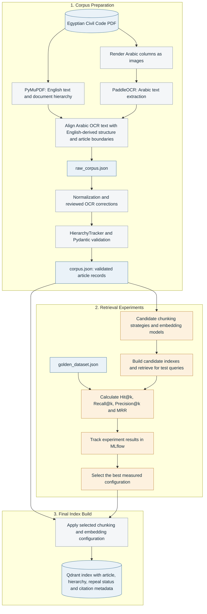
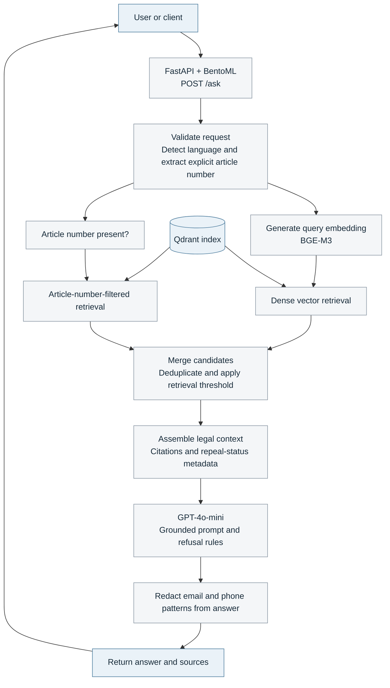

# Egyptian Civil Code — Arabic Legal Q&A RAG

A bilingual (Arabic/English) Retrieval-Augmented Generation system over the Egyptian Civil Code (https://sadanykhalifa.com/uploads/Laws/1576751803.pdf), built as a production-style MLOps pipeline 

> A law firm or government authority needs to ask questions about Egyptian civil law and get an answer that cites the exact article it came from — never a plausible-sounding guess. This project treats retrieval, not just generation, as the component that has to be right

---

## Table of Contents

- [Quick Start](#quick-start)
- [Architecture](#architecture)
- [Key Engineering Decisions](#key-engineering-decisions)
- [Tech Stack](#tech-stack)
- [Evaluation](#evaluation)
- [Project Structure](#project-structure)
- [Reproducibility](#reproducibility)
- [Observability & Production Monitoring](#observability--production-monitoring)
- [Testing & Load Testing](#testing--load-testing)
- [Known Limitations](#known-limitations)


---

## Quick Start

The published Docker image (`mariiamayman/legal_rag_service:latest`) ships with the vector database and processed corpus already embedded — no local GPU, model downloads, or data pipeline run required to serve questions.

```bash
git clone https://github.com/mariamayman29/Arabic-Legal-RAG-System.git && cd legal_rag

cp .env.example .env

docker compose up -d
```

The API is reachable at `http://localhost:8000`

```bash
curl -X POST http://localhost:8000/ask \
  -H "Content-Type: application/json" \
  -d '{"question": "ما هي شروط صحة العقد؟", "stream": false}'
```

Health check: `POST/ask` is the main endpoint; `GET /health` reports index status; `GET /metrics` exposes Prometheus metrics.

### Rebuilding the image from source

This is the path that exercises the full pipeline — PDF ingestion, chunking experiments, and index building — rather than just running the published image.

```bash
dvc pull                              
uv run dvc repro                      
uv run python -m legal_rag.indexing.chunker --strategy article_level_enriched_bgem3
bentoml build
bentoml containerize legal_rag_service:latest
docker push <your-registry>/legal_rag_service:latest
```

---

## Architecture

### 1. Offline Data Pipeline & Indexing


### 2. Online Question-Answering Flow


---

## Key Engineering Decisions

- **English and Arabic are extracted by different tools, deliberately.** PyMuPDF's native text layer was reliable for English from the start and is the sole source of truth for article numbers and the book/chapter/section/topic hierarchy. Arabic required falling back to OCR (PaddleOCR on rendered column images) after five text-layer-based methods all left at least one reproducible, silent reordering or ligature-swap defect. The Arabic side's own extracted article markers are never parsed for their value — they're boundary signals only
- **Data-Driven Embedding Selection** Rather than guessing which multilingual model would work best for Egyptian legal Arabic, we treated embedding selection as a formal ML experiment. We evaluated **BAAI/bge-m3** against **multilingual-e5-small** using MLflow, explicitly selecting BGE-M3 because it delivered superior Recall@k and MRR on our golden dataset
- **Metadata Filtering over Pure Semantic Search** Legal RAG cannot afford to hallucinate article numbers. We architected the retrieval step to execute a hybrid approach within Qdrant: using strict payload filtering (filtering by article number, book, and repealed status) alongside dense semantic search


---

## Tech Stack

| Layer | Choice | Why |
|---|---|---|
| PDF structure / English text | PyMuPDF | Reliable from the first test; also used for table/column geometry detection |
| Arabic text | PaddleOCR | Only method that correctly handled Arabic word order and ligatures after five text-layer approaches failed |
| Schema validation | Pydantic (`ArticleSchema`, `ChunkSchema`) | Enforces citation-format correctness and repealed-article consistency at write time, not just at read time |
| Vector store | Qdrant | Payload filtering (article number, language, repealed flag) alongside dense search, in one query |
| Embeddings | `BAAI/bge-m3` | Selected over `multilingual-e5-small` via the MLflow retrieval comparison below |
| Generation | `gpt-4o-mini` (OpenAI) | Selected generator for the production pipeline; compared across prompt variants via RAGAS |
| Serving | FastAPI wrapped by BentoML (`@bentoml.asgi_app`) | Streaming `/ask`, containerized, deployed via Docker Compose |
| Experiment tracking | MLflow | Retrieval-strategy comparison and prompt comparison, each as their own experiment |
| Observability | Langfuse (self-hosted v3 OSS) | Per-request tracing with nested retrieval/generation spans |
| Infra metrics | Prometheus + Grafana | Token-usage counters scraped from the running service |
| Pipeline reproducibility | DVC | Source PDF and corpus.json tracked as pipeline stages (`dvc.yaml`) |
| Dependency management | uv | Separate environments for the main service and the evaluation stack (RAGAS's dependency tree is large and was kept isolated after a real conflict during setup) |
| Load testing | Locust | `/ask` endpoint under concurrent load |

---

## Evaluation

### Retrieval: chunking strategy × embedding model

Compared via MLflow (`Legal_RAG_Retrieval_Benchmark` experiment), scored against the labeled golden dataset with Hit@k, Recall@k, Precision@k, and MRR:

| Strategy | Chunking | Embedding model | Hit@3 | Recall@3 | MRR |
|---|---|---|---|---|---|
| `baseline_small_recursive` | 150 chars / 30 overlap | e5-small | | | |
| `baseline_medium_recursive` | 300 chars / 50 overlap | e5-small | | | |
| `baseline_large_recursive` | 500 chars / 100 overlap | e5-small | | | |
| `article_level_raw` | one chunk per article | e5-small | | | |
| `article_level_enriched` | + hierarchy header | e5-small | | | |
| **`article_level_enriched_bgem3`** | + hierarchy header | **BGE-M3** | | | **winning configuration** |

*see reports/evalutation_runs_mlflow*

### Generation: prompt comparison

Compared via MLflow (`Legal_RAG_Prompt_Optimization` experiment), scored with RAGAS (faithfulness, answer relevancy, context precision, context recall), holding retrieval constant across both candidates:

| Prompt | Faithfulness | Answer Relevancy | Context Precision | Context Recall |
|---|---|---|---|---|
| `prompt_a_direct` | | | | |
| `prompt_b_structured` | | | | |

*see reports/prompt_optimization_mlflow*

Run the comparisons yourself:
```bash
uv run python -m legal_rag.eval.evaluate_retrieval
uv run python -m legal_rag.eval.evaluate_generation
mlflow ui   # view both experiments at http://localhost:5000
```

---

## Project Structure

```
legal_rag/
├── data/                       # DVC-tracked: civil_code.pdf, raw_corpus.json, corpus.json, qdrant_db/
├── eval/
│   ├── golden_dataset.json     # labeled questions: target article numbers, language, query type
│   ├── evaluate_retrieval.py   # Hit@k / Recall@k / Precision@k / MRR across all chunking strategies
│   ├── evaluate_generation.py  # RAGAS prompt comparison, holding retrieval constant
│   ├── evaluate_production.py  # scheduled batch RAGAS scoring of live Langfuse traces
│   └── register.py
├── src/legal_rag/
│   ├── api/                    # app.py, schemas.py, service.py (BentoML entrypoint)
│   ├── ingestion/               # PDF extraction, OCR, hierarchy tracking, normalization
│   ├── indexing/                 # chunker.py — chunking strategies + Qdrant indexing
│   ├── retrieval/                # retrieve_legal_context()
│   ├── core/
│   └── utils/                    # config.py, logging_config.py, helper.py
├── tests/  
├── reports/                     
├── dvc.yaml / dvc.lock
├── bentofile.yaml
├── locustfile.py
├── docker-compose.yaml
└── pyproject.toml / uv.lock
```

---

## Reproducibility

The corpus is a two-stage DVC pipeline, not a hand-run script:

```yaml
stages:
  extract_raw_corpus:    # PDF -> raw_corpus.json (PyMuPDF + PaddleOCR + hierarchy tracking)
  postprocess_corpus:    # raw_corpus.json -> corpus.json (normalization, reviewed OCR corrections)
```

`dvc repro` rebuilds the corpus from the source PDF exactly, and `dvc.lock` pins the inputs so a reviewer gets the same output. The source PDF and both JSON artifacts are DVC-tracked rather than committed to git directly.

---

## Observability & Production Monitoring

- **Per-request tracing (Langfuse):** every `/ask` call produces a root span with a nested retrieval span and a nested LangChain generation span, so a slow or wrong answer can be traced back to whether retrieval or generation was the cause.
- **PII redaction:** emails and Egyptian phone number formats are redacted from the final answer before it's returned.
- **Data drift signal:** each incoming query's embedding is compared (cosine similarity) against a fixed baseline query embedding and logged — a sustained drop signals the query distribution has shifted from what the system was built and evaluated against.
- **Infra metrics:** token usage counters are scraped by Prometheus and visualized in Grafana.
- **Production RAGAS monitoring:** `evaluate_production.py` runs on a schedule, pulls recent traces tagged `legal_rag_api` from Langfuse, re-scores them with RAGAS, writes the scores back onto the original traces in Langfuse, and logs batch averages to a dedicated MLflow experiment — with an alert if any metric's average drops below 0.80.

---

## Testing & Load Testing

```bash
uv run pytest                 
uv run locust -f locustfile.py --host http://localhost:8000
```

---

## Known Limitations

- **Arabic paragraph-level markers (`(١)`, `(٢)`) are not reliably recovered from OCR** for all multi-paragraph articles. Article-level citation is unaffected; paragraph-level citation within a long article is the known gap.
- **Single-document scope.** This system answers from the Egyptian Civil Code only. A question about a different Egyptian law, or another jurisdiction's law, is out of scope by design — the system's refusal protocol is expected to trigger rather than guess.
- **Vector store runs in Qdrant's local/embedded mode**, chosen deliberately for a corpus this size (~1,100 articles) over standing up a separate server; the Docker image's self-contained design follows from this.
- **Cloud LLM vs. Local Inference (vLLM)** The generation step relies on OpenAI's gpt-4o-mini API rather than a locally hosted open-source model (e.g., Llama 3 or Qwen via vLLM). This was a strict hardware constraint; our local development machines lacked the necessary GPU VRAM to serve a generative LLM efficiently while simultaneously running Qdrant, the BGE-M3 embedding pipeline, and the BentoML service wrappers

---


